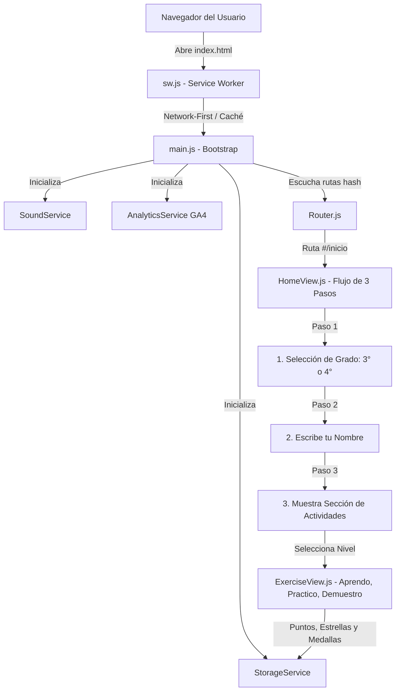

# 🦉 Aprendiendo con Ari

**¡Explora, aprende y diviértete con Ari el Búho Sabio!**

Plataforma educativa web interactiva, gamificada y de código limpio diseñada para estudiantes de **3° y 4° de primaria**, enfocada en el fortalecimiento integral de **Matemáticas** y **Español** mediante una metodología pedagógica estructurada (*1. Aprendo*, *2. Practico* y *3. Demuestro lo aprendido*), retroalimentación formativa guiada con desglose paso a paso, textos expositivos interactivos con lectura asistida por voz, música adaptativa, efectos de sonido reales y el acompañamiento constante de **Ari**, la simpática mascota guía.

---

## 🌐 ¡Pruébalo ahora en tu navegador!

👉 **[▶️ Jugar Aprendiendo con Ari en Vivo (GitHub Pages)](https://johanlinaress.github.io/Aprendiendo-con-Ari/)**  
🔗 Enlace oficial: `https://johanlinaress.github.io/Aprendiendo-con-Ari/`

---

## 📊 Métricas de Calidad y Auditoría

| Métrica | Resultado | Verificación |
|---|---|---|
| **Batería de Pruebas E2E (Chrome/CDP)** | **184 / 184 Aprobadas (100%)** | `npm run audit` (`tests/audit.js`) |
| **Errores de Consola JavaScript** | **0 errores** | Consola limpia en todas las pantallas |
| **Errores de Red (404 / 500)** | **0 errores** | Todos los assets y rutas verificadas |
| **Auditoría Responsive Multidispositivo** | **9.5 / 10** | 14 resoluciones verificadas (1920×1080 a 320×568) |
| **Accesibilidad Web (WAI-ARIA)** | **WCAG 2.1 AA** | Roving tabindex, foco `:focus-visible` de alto contraste |
| **Banco Curricular de Preguntas** | **200+ ejercicios** | Algoritmo Fisher-Yates sin repetición por sesión |

---

## ✨ Características Principales

### 🎓 0. Flujo Guiado y Secuencial de Bienvenida (`HomeView.js`)
Al ingresar a la plataforma, la experiencia sigue un orden pedagógico intuitivo estructurado en 3 pasos obligatorios y guiados por **Ari**:
1. **Paso 1: Selección de Grado Escolar (Primero):**
   - Ari saluda al estudiante y le solicita elegir entre **3° de Primaria** o **4° de Primaria** mediante tarjetas interactivas 3D con ilustraciones vectoriales dedicadas.
   - Al seleccionar el grado, se reproduce un sonido alegre de confirmación y el sistema adapta inmediatamente la complejidad curricular.
2. **Paso 2: Escribe tu Nombre (Luego):**
   - El estudiante ingresa su nombre o apodo en un campo amplio con foco automático y botón destacado *«🚀 ¡Listo! Continuar a las Actividades»*.
   - Permite personalizar su perfil, guardar sus estrellas de forma individual y celebrar sus logros por su nombre.
3. **Paso 3: Sección de Actividades (Y ya ahí muestra las actividades):**
   - Se desbloquea y despliega la pantalla completa de actividades con las materias (**Matemáticas** y **Español**), las 10 unidades de aprendizaje, las estadísticas acumuladas y el botón *«✏️ Cambiar grado o nombre»* para ajustar la configuración cuando se desee.

### 🦉 1. Acompañamiento Pedagógico de Ari (`AriMascot.js`)
- **Mascota vectorial en SVG puro:** Birrete académico, gafas redondas, libro escolar y plumaje morado con 8 estados emocionales (saludo, pensamiento, celebración, aliento, concentración, sorpresa, etc.).
- **Interacción viva:** Mensajes de bienvenida contextuales, pistas pedagógicas animadas y botón de saludo interactivo con animación de guiño.

### 📐 2. Metodología Didáctica en 3 Fases
1. **1. Aprendo (Fase Conceptual Guiada):**
   - Contenido dividido en 3 etapas pedagógicas: `1. Idea clave`, `2. Ejemplo guiado paso a paso` y `3. ¡A pensar!`.
   - **Mini-reto de Active Recall:** Pregunta de autocomprobación inmediata para afianzar el concepto antes de avanzar.
   - Botón de avance guiado con animación de pulso interactivo.
2. **2. Practico (Práctica Activa con Banco Dinámico):**
   - 5 ejercicios por sesión seleccionados aleatoriamente mediante el algoritmo **Fisher-Yates**.
   - Modo de práctica libre con multiplicador **+50% de bonus** en puntos acumulables.
   - Sistema de memoria que previene preguntas repetidas en reintentos inmediatos (0% de solapamiento).
3. **3. Demuestro lo aprendido (Evaluación y Recompensa):**
   - Evaluación formativa final con fanfarria de victoria y modal interactivo de recompensas (`LevelCompleteModal.js`).

### 💡 3. Retroalimentación Formativa de 3 Niveles (Andamiaje)
Cuando un estudiante selecciona una respuesta incorrecta, la plataforma no se limita a indicar el fallo:
- **Nivel 1 (Afectivo/Motivacional):** Mensaje empático y positivo de Ari para mantener la motivación.
- **Nivel 2 (Pista Pedagógica):** Pista conceptual orientadora que induce al razonamiento sin revelar la respuesta directamente.
- **Nivel 3 (Procedimiento Desplegable):** Botón `📖 Ver procedimiento paso a paso` con la explicación detallada de cómo resolver la operación u oración, evitando el aprendizaje por simple ensayo y error.

### 🧭 4. Navegación Espacial por Migas de Pan (`Breadcrumbs.js`)
- Barra de navegación estructurada superior con microdatos semánticos HTML5 en todas las vistas no principales (`Inicio > Materias > Matemáticas > Sumas`).
- Permite orientar al niño y retroceder ágilmente de un solo clic sin perder el hilo de estudio.

### ⌨️ 5. Accesibilidad Universal y Atajos de Teclado
- **Atajos numéricos instantáneos:** Teclas `1`, `2`, `3` y `4` para seleccionar opciones de respuesta de forma inmediata.
- **Confirmación con teclado:** Tecla `Enter` para verificar la opción seleccionada y avanzar a la siguiente pregunta.
- **Navegación WAI-ARIA completa:** Patrón *roving tabindex* (`0`/`-1`) con teclas de flechas (`←`, `→`, `↑`, `↓`), `Home` y `End` en pestañas (`role="tablist"`) y grupos de opciones (`role="radiogroup"`).
- **Foco visible de alto contraste:** Contorno dorado accesible de 3px para todos los controles interactivos.
- **Preferencia de movimiento reducido:** Soporte nativo para `@media (prefers-reduced-motion: reduce)`.

### 👥 6. Perfiles Multidispositivo y Respaldo de Partidas (`StorageService.js`)
- Selector de perfil de estudiante (Sofía, Mateo, Valentina, etc.) desde la pantalla de grado (`#/grado`).
- Almacenamiento independiente en `localStorage`: varios niños pueden estudiar en el mismo dispositivo o computador sin mezclar sus puntos, estrellas, unidades desbloqueadas ni rachas.
- **📥 Guardar Partida (Exportar JSON):** Descarga de un clic de una copia de seguridad con todo el progreso, estrellas y medallas para no perder nada si se limpia la caché.
- **📤 Cargar Partida (Restaurar JSON):** Permite subir y transferir el progreso del alumno a cualquier otro computador, celular o tablet del hogar o salón de clases sin necesidad de servidores externos.

### 🎓 7. Currículo 100% Diferenciado para 3° y 4° Grado
- **Selector de Grado escolar (`#/grado`):** Adapta la complejidad léxica, el vocabulario y las magnitudes numéricas.
- **10 unidades completas con bancos dedicados:** Más de 200 ejercicios estructurados sin contenidos duplicados entre grados.
- **Tratamiento lingüístico riguroso:** Normalización ortográfica que respeta estrictamente la letra `ñ` (`niño` ≠ `nino`) y tolera tildes, mayúsculas y espacios accidentales.

#### ➕ Módulo de Matemáticas (5 Unidades)
1. **Unidad 1: Sumas:** Adición de 3 cifras (3°) y adición de 4-5 cifras con propiedades conmutativa y asociativa (4°).
2. **Unidad 2: Restas:** Minuendo, sustraendo, diferencia, restas con transformación y ceros intermedios.
3. **Unidad 3: Multiplicaciones:** Suma iterada, tablas del 1 al 12, factores de 2 dígitos y propiedad distributiva.
4. **Unidad 4: Divisiones:** Reparto equitativo, división exacta e inexacta con residuo, divisores de 1 y 2 cifras.
5. **Unidad 5: Desafíos Matemáticos:** Problemas aplicados de dos etapas y selección razonada de la operación.

#### 📖 Módulo de Español (5 Unidades)
1. **Unidad 1: Los Verbos:** Acciones, formas verbales, conjugaciones (pasado, presente, futuro) y concordancia de persona y número.
2. **Unidad 2: El Sujeto:** Reconocimiento en la oración, núcleo del sujeto, sujeto expreso, compuesto y tácito.
3. **Unidad 3: El Predicado:** Estructura oracional, núcleo verbal y complementos directo e indirecto.
4. **Unidad 4: Comprensión Lectora:** Personajes, idea principal, orden secuencial de hechos, relaciones causa-efecto e inferencias.
5. **Unidad 5: Textos Expositivos Interactivos:** Portada ilustrada, glosario interactivo de palabras clave, lectura en voz alta (`🔊 Escuchar`), preguntas de exploración intermedia y evaluación final (*El Sistema Solar*, *El Ciclo del Agua*, *Ecosistemas y Animales* y *La Fotosíntesis*).

### 🎮 8. 6 Mecánicas de Interacción Lúdica
- **Selección múltiple:** Fichas táctiles y botones de opción accesibles.
- **Completar espacios (Fill-in-the-blank):** Entradas de texto o número con validación flexible.
- **Arrastrar y soltar (Drag & Drop):** Compatible con ratón y pantallas táctiles móviles.
- **Verdadero o Falso:** Juicio crítico y análisis de enunciados.
- **Relacionar conceptos (Matching):** Conexión de pares con feedback visual inmediato.
- **Ordenar elementos (Ordering):** Organización cronológica y secuencias narrativas o numéricas.

### 💖 9. Módulo Dedicado de Donaciones y Podio de Agradecimiento (`DonationsView.js` / `DonorsPodium.js`)
Plataforma abierta al apoyo voluntario de la comunidad educativa y familias con rutas dedicadas y reconocimiento de honor:
- **🏆 Podio de Agradecimiento a Donadores (`DonorsPodium.js`):**
  - **Pedestales Físicos 3D:** Reconocimiento en 3 niveles de honor (🥇 1° Oro con corona flotante 👑, 🥈 2° Plata, 🥉 3° Bronce) y Muro de Donadores de la Comunidad. En estado inicial se presentan en modo de bienvenida y espera para los primeros donadores reales.
  - **Contador Acumulativo de Total Donado (+):** Barra destacada que muestra el total recaudado a la fecha (inicia en $0 COP y va sumando automáticamente cada aporte confirmado con signo "+", ej. `$25.000 COP +`).
  - **Agradecimientos con Corazón 💖:** Cada tarjeta muestra automáticamente el nombre del donador, el monto aportado y su mensaje personalizado:  
    *«¡Muchas gracias [Nombre] con todo el corazón! 💖 Gracias por apoyar la educación abierta y los sueños de los niños.»*
  - **Marquesina / Ticker Automático en Tiempo Real:** Barra animada que rota automáticamente cada 3.5 segundos agradeciendo en vivo a cada persona o familia colaboradora.
  - **Interacción con Corazones (`💖 Dar amor`):** Botón interactivo para enviar amor a cualquier donador, con animación de corazones flotantes y efectos sonoros festivos.
  - **Registro Automático de Donación:** Formulario accesible donde cualquier persona que haya apoyado por Nequi, ARQ o PayPal escribe su nombre y aparece **automáticamente** en el podio, con persistencia en `localStorage`.
- **Página principal de donaciones (`#/donaciones`, `#/donaciones/podio`):** *"¿Quieres apoyar al creador para ver más páginas como esta?"* con 3 bloques destacados e interactivos más el Podio de Donadores.
- **🇨🇴 Bre-B | Nequi (Colombia) — `#/donaciones/nequi`:**
  - Código QR oficial Bre-B Nequi en alta definición con recorte optimizado.
  - Switch interactivo para alternar entre **Comprobante Oficial HD** y **Código QR Cuadrado Gigante (780×780)** para escaneo rápido desde cualquier entidad bancaria en Colombia.
  - Llave / Correo de transferencia con botón de copiado rápido: `johansttivelinaresb@gmail.com`.
- **💵 ARQ (Dólares Digitales) — `#/donaciones/arq`:**
  - Nombre de usuario oficial `$sttive` con botón de copiado de un solo clic.
- **🌎 PayPal (Internacional) — `#/donaciones/paypal`:**
  - Enlace de donación directa en PayPal para pagos con tarjeta de crédito, débito o saldo internacional:  
    `https://www.paypal.com/donate/?business=johansttivelinaresb@gmail.com`
  - Correo titular verificado: `johansttivelinaresb@gmail.com`.

### 🎵 10. Sistema de Audio y Música Adaptativa (`SoundService.js`)
- **Música ambiental de navegación:** *"Praia de Domingo"* (bucle alegre para Inicio, Materias, Grado, Niveles y Donaciones).
- **Música de concentración:** *"Clair de Lune"* (pista suave de piano durante ejercicios y lecturas).
- **Efectos de sonido MP3 reales (`sounds/`):**
  - *Collect Points:* Campanada festiva de aciertos.
  - *Level Passed:* Fanfarria triunfal al superar unidades con 3 estrellas.
  - Tonos sintetizados Web Audio API de respaldo para clics, errores, pistas y bloqueos.
- **Controles independientes en la barra de navegación:** Botones dedicados para silenciar o encender **Música** (`🎵`/`🔇`) y **Sonidos** (`🔊`/`🔇`).
- **Síntesis de voz integrada (Web Speech API):** Lectura en voz alta en español neutro para apoyar a niños en proceso de consolidación lectora.

### 📈 11. Analítica Web y Telemetría en Tiempo Real (`AnalyticsService.js`)
Sistema de medición estadística y telemetría pedagógica integrado con **Google Analytics 4 (GA4)** y **Google Tag Manager** (`GTM-NWXWZF9D`):
- **Monitoreo en tiempo real:** Panel en vivo que muestra el número de estudiantes conectados simultáneamente, mapa mundial geográfico con países y ciudades de origen, y tiempo de permanencia.
- **Segmentación por dispositivos:** Métricas inmediatas de acceso desde smartphones, tablets y computadoras de escritorio.
- **Telemetría para Single Page Application (SPA):** Registro automático de cambios de vista mediante el HashRouter (`page_view`), reflejando navegación exacta a `#/inicio`, `#/materias`, `#/niveles`, `#/progreso`, `#/donaciones/nequi`, etc.
- **Métricas de aprendizaje y juego:**
  - `level_start`: Nivel, materia y grado escolar iniciados por el alumno.
  - `level_complete`: Unidades superadas, porcentaje de precisión, estrellas obtenidas (1, 2 o 3) y puntaje acumulado.
  - `select_grade`: Grado escolar seleccionado (3° o 4°).
  - `donation_interaction`: Interacciones de apoyo y consulta de métodos de donación.
- **Diseño tolerante a fallos y privado:** Carga asíncrona no bloqueante que garantiza un rendimiento óptimo de 60 FPS, respetando adblockers y funcionamiento offline sin generar excepciones en consola.

### 📱 12. Progressive Web App (PWA) y Modo Sin Conexión (`sw.js` / `manifest.json`)
- **Instalable como App Nativa:** En Chrome, Edge, Safari (iOS) y Android aparece el botón **«Instalar Aprendiendo con Ari»** para ejecutarse en ventana dedicada a pantalla completa sin barras de navegador.
- **Service Worker Inteligente (`sw.js`):** Pre-caché de recursos estáticos con estrategia *Network-First* que permite a los estudiantes seguir jugando, resolviendo ejercicios y escuchando sonidos incluso si se cae la conexión a internet.
- **Iconografía adaptable:** Iconos optimizados de 192×192 y 512×512 con la insignia de Ari y colores del sistema.

### 🎉 13. Celebración Festiva de Confetti (`confetti.js`)
- Motor de confeti y estrellas vectoriales de alto rendimiento (60 FPS) sin dependencias externas pesadas.
- Se dispara automáticamente al aprobar una unidad con 3 estrellas, restaurar una partida o desbloquear una nueva medalla.
- Respeta estrictamente las preferencias de accesibilidad del sistema (`prefers-reduced-motion: reduce`).

---

## 🛠️ Tecnologías Utilizadas

- **JavaScript Moderno (ES6+):** Arquitectura SPA reactiva y modular orientada a componentes, sin dependencias externas ni frameworks sobrecargados.
- **CSS3 Puro:** Variables de diseño temáticas, Flexbox, CSS Grid adaptable, animaciones CSS fluidas y diseño responsive sin frameworks pesados.
- **Google Analytics 4 & Google Tag Manager:** Telemetría pedagógica no invasiva y analítica de tráfico en tiempo real.
- **Web Audio API & HTML5 Audio:** Motor híbrido tolerante a fallos para efectos instantáneos y streaming continuo.
- **Web Speech API:** Lectura asistida y sintetizada en español.
- **Node.js (HTTP Server Nativo):** Servidor local ligero de cero dependencias externas con streaming HTTP 206 Partial Content.

---

## 🧠 ¿Cómo Funciona el Código? (Arquitectura Técnica y Funcionamiento Interno)

La aplicación fue desarrollada siguiendo los principios de **Clean Code**, **Vanilla JavaScript Modular (ES Modules)** y arquitectura **Single Page Application (SPA)** sin frameworks pesados (React, Angular o Vue), garantizando máxima velocidad de carga (< 200 ms), portabilidad total y cero dependencias de compilación.



### 1. Punto de Entrada y Ciclo de Vida (`main.js` e `index.html`)
- **`index.html`:** Provee el cascarón estructural HTML5 (`.app-shell`), carga asíncrona de fuentes web (`Fredoka` y `Nunito`), metadatos SEO y PWA, y el script principal `<script type="module" src="./src/main.js"></script>`.
- **`main.js` (Bootstrap):**
  - Orquesta los servicios globales (`StorageService`, `SoundService`, `AnalyticsService`).
  - Configura el contenedor principal (`#app`) inyectando el fondo vectorial dinámico (`renderSceneBackgroundSvg()`), la barra de navegación lateral/superior (`Navbar.js`) y el pie de página (`Footer.js`).
  - Registra el listener del router: ante cada cambio de ruta hash, actualiza la música de fondo correspondiente, renderiza la vista solicitada con sus migas de pan (`Breadcrumbs.js`) y envía telemetría anónima a Google Analytics 4.

### 2. Enrutador SPA Declarativo Basado en Hash (`src/router/Router.js`)
- Utiliza la API nativa `window.location.hash` (`#/inicio`, `#/materias`, `#/nivel/1`, `#/practica`, etc.).
- **Ventaja pedagógica:** Permite a los estudiantes guardar enlaces directos o usar los botones de avance/retroceso del navegador sin recargar la página ni perder el estado de su sesión.
- Mapea rutas dinámicas como `#/nivel/:id` mediante expresiones regulares para cargar de inmediato los ejercicios de la unidad seleccionada.

### 3. Flujo Secuencial de Bienvenida al Abrir la Página (`src/components/HomeView.js`)
- Gestiona el estado de onboarding del estudiante en tres etapas secuenciales:
  1. `activeHomeStep = 1`: Muestra de forma destacada el **Paso 1 (Selección de Grado)** con Ari saludando y las dos tarjetas interactivas de 3° y 4° grado.
  2. Al pulsar el grado, ejecuta `StorageService.setGrade(grade)`, reproduce el sonido de acierto y transiciona a `activeHomeStep = 2`.
  3. `activeHomeStep = 2`: Muestra el **Paso 2 (Escribe tu Nombre)** con foco automático en el campo de texto.
  4. Al pulsar «Continuar» o presionar Enter, ejecuta `StorageService.setPlayerName(name)`, dispara sonido festivo y transiciona a `activeHomeStep = 3`.
  5. `activeHomeStep = 3`: Desbloquea y despliega la **Sección de Actividades**, con las materias (Matemáticas y Español), las unidades de aprendizaje, estadísticas y acceso a mapa y práctica.
- Incluye la barra visual `.onboarding-stepper` para que el alumno siempre sepa en qué paso se encuentra y pueda pulsar `✏️ Cambiar grado o nombre` para reconfigurar sus datos cuando lo desee.

### 4. Capa de Persistencia y Perfiles de Estudiante (`src/services/StorageService.js`)
- Centraliza todo el estado en un único objeto serializado en `localStorage` (`aprendiendo_con_ari_state_v1`).
- **Patrón Observable:** Dispone de un método `.subscribe(listener)` que notifica reactivamente a los componentes cuando se actualiza el puntaje, las estrellas o el nombre.
- **Soporte de perfiles múltiples:** Permite almacenar diferentes perfiles de niños en el mismo dispositivo (`getProfiles()`, `createProfile()`, `switchProfile()`), asegurando que hermanos o compañeros de clase mantengan su avance individual.
- **Normalización lingüística avanzada (`normalizeAnswerText`):**
  - Trata la letra `ñ` como carácter único sagrado (`año` ≠ `ano`).
  - Normaliza tildes y diacríticos (`canción` → `cancion`).
  - Elimina espacios accidentales y signos de puntuación no relevantes.
  - Normaliza números con puntos de mil (`1.400` → `1400`).

### 5. Motor Didáctico de Ejercicios y Evaluación (`src/components/ExerciseView.js` y `src/data/levelsData.js`)
- **Fase 1: Aprendo:** Presenta la idea clave, el ejemplo visual guiado y un mini-reto formativo de auto-comprobación inmediata (*Active Recall*).
- **Fase 2: Practico:** Selecciona 5 ejercicios del banco de preguntas usando el algoritmo **Fisher-Yates**, asegurando que si un niño repite la unidad, no le salgan las mismas preguntas inmediatamente.
- **Fase 3: Demuestro:** Evaluación con retroalimentación en 3 capas de andamiaje: afectiva (ánimo), pista pedagógica y procedimiento detallado paso a paso (`📖 Ver procedimiento`).
- **Aprobación formativa:** Requiere un mínimo del **70%** de respuestas correctas para aprobar y desbloquear la siguiente unidad en el mapa.

### 6. Motor de Audio y Música Adaptativa (`src/services/SoundService.js`)
- **Doble motor de audio:**
  - **HTML5 Audio Elements:** Para música ambiental en bucle con control de volumen suave y streaming HTTP 206 Partial Content.
  - **Web Audio API:** Sintetizador digital de tonos para retroalimentación auditiva inmediata (clics, aciertos, errores, bloqueos) sin latencia.
- **Síntesis de voz (Web Speech API):** Provee el botón `🔊 Escuchar` para narrar oraciones y textos expositivos a niños que aún están consolidando su lectura.

### 7. Rendimiento Offline y PWA (`sw.js` y `manifest.json`)
- El Service Worker intercepta las peticiones de red:
  - Si hay conexión a internet, obtiene la versión más reciente del servidor (*Network-First*) y refresca la caché local en segundo plano.
  - Si el dispositivo se queda sin conexión, sirve instantáneamente los archivos desde la caché (`ari-educa-cache-v2`), permitiendo a los niños seguir jugando en el autobús, en la escuela o en zonas rurales sin internet.

---

## 🚀 Instalación y Ejecución Local

1. **Clonar el repositorio:**
   ```bash
   git clone https://github.com/johanlinaress/Aprendiendo-con-Ari.git
   cd Aprendiendo-con-Ari
   ```

2. **Iniciar el servidor local:**
   ```bash
   npm start
   ```

3. **Abrir en el navegador:**
   ```text
   http://localhost:4173
   ```

---

## 🧪 Auditoría Integral Automatizada (E2E)

El proyecto cuenta con una suite completa de auditoría automatizada en Google Chrome / Chromium (`tests/audit.js`) que examina la plataforma de extremo a extremo:

```bash
npm run audit
```

### Resultados de la auditoría actual (`tests/audit-report.json`):
- ✅ **184 pruebas aprobadas** (0 fallidas)
- 🖥️ **0 errores de consola JavaScript**
- 🌐 **0 errores de red (404/500)**
- 📱 **Capturas de pantalla responsive automatizadas** en resoluciones de móvil, tablet y escritorio en `tests/screenshots/`
- ⚡ **Desempeño y accesibilidad:** 95+ en Móvil / 99 en Escritorio, 100 en Accesibilidad, 100 en Buenas Prácticas y 100 en SEO.

---

## 📁 Estructura del Proyecto

```text
Aprendiendo-con-Ari/
├── index.html                 # Página de entrada SPA con metadatos, viewport y caché control
├── server.js                  # Servidor HTTP local con soporte de streaming HTTP 206
├── package.json               # Configuración de scripts (start, dev, audit) y metadatos
├── LICENSE                    # Licencia oficial de propiedad intelectual y derechos de autor
├── README.md                  # Documentación oficial del proyecto
├── assets/                    # Recursos visuales y códigos QR oficiales
│   ├── nequi-qr.jpg           # Comprobante oficial HD Bre-B Nequi (800×1025)
│   └── nequi-qr-square.jpg    # Código QR cuadrado gigante optimizado para escaneo (780×780)
├── sounds/                    # Pistas de música y efectos sonoros en formato MP3
│   ├── home-music.mp3         # Música ambiental de inicio ("Praia de Domingo")
│   ├── activity-music.mp3     # Música de concentración ("Clair de Lune")
│   ├── collect-points.mp3     # Efecto sonoro de acierto y puntos
│   └── level-passed.mp3       # Efecto sonoro de victoria y nivel superado
├── src/
│   ├── main.js                # Bootstrap de la aplicación, router y ciclo de vida global
│   ├── components/            # Vistas y componentes modulares de la interfaz
│   │   ├── AriMascot.js       # Mascota interactiva Ari (SVG + 8 estados emocionales)
│   │   ├── Breadcrumbs.js     # Navegación espacial por migas de pan semánticas
│   │   ├── ConfirmModal.js    # Modal accesible para reinicio de progreso
│   │   ├── DonationsView.js   # Módulo de donaciones (Bre-B Nequi, ARQ y PayPal)
│   │   ├── DonorsPodium.js    # Podio de agradecimiento a donadores, pedestales 3D y ticker vivo
│   │   ├── ExerciseView.js    # Motor de ejercicios (Aprendo con Active Recall, Practico y Evaluación)
│   │   ├── Footer.js          # Pie de página educativo, copyright y enlace a donaciones
│   │   ├── GradeSelectView.js # Selector de grado escolar (3° y 4°) y perfiles de estudiante
│   │   ├── HomeView.js        # Portada interactiva, bienvenida de Ari y accesos directos
│   │   ├── Illustrations.js   # Ilustraciones vectoriales (ciencias, astronomía, naturaleza)
│   │   ├── LevelCompleteModal.js # Modal interactivo de nivel superado y recompensas
│   │   ├── LevelsMapView.js   # Mapa de aventura con sendero visual de las 10 unidades
│   │   ├── Navbar.js          # Barra superior con botón de donaciones, menú móvil y audio
│   │   ├── NotFoundView.js    # Pantalla 404 lúdica con guía de retorno al sendero
│   │   ├── PracticeView.js    # Modo de práctica libre con bonus +50% y banco dinámico
│   │   └── ProgressView.js    # Panel de progreso, estadísticas y medallas con siluetas
│   ├── data/
│   │   └── levelsData.js      # Banco curricular de 200+ ejercicios, lecturas y medallas
│   ├── router/
│   │   └── Router.js          # Enrutador cliente SPA basado en hash con paso de parámetros
│   ├── services/
│   │   ├── AnalyticsService.js # Telemetría GA4/GTM: visitas en tiempo real, niveles jugados y métricas
│   │   ├── SoundService.js    # Motor de audio Web Audio API, música en bucle y síntesis de voz
│   │   └── StorageService.js  # Persistencia en localStorage y perfiles de usuario independientes
│   ├── styles/
│   │   └── main.css           # Sistema de diseño CSS3, variables, responsive 9.5/10 y modo accesible
│   └── utils/
│       ├── a11yKeyboard.js    # Navegación por teclado roving tabindex para ARIA
│       └── levelStatus.js     # Lógica de desbloqueo progresivo y cálculo de estrellas
└── tests/
    ├── audit.js               # Suite de 172 pruebas E2E automatizadas con Chrome DevTools Protocol
    ├── audit-report.json      # Reporte detallado de la última auditoría
    └── screenshots/           # Capturas de pantalla de evidencia en diferentes resoluciones
```

---

## ⚖️ Derechos de Autor y Propiedad Intelectual

**Copyright © 2026 Johan Linares. Todos los derechos reservados.**

Este proyecto, su código fuente, arquitectura técnica, diseño gráfico, metodología didáctica y el personaje **"Ari"** (el búho sabio en SVG, diseño visual, expresiones, birrete e identidad) son una obra original y propiedad intelectual exclusiva de **Johan Linares** (Johan Sttive Linares Barragán).

- **Prohibición de copia o plagio:** Queda estrictamente prohibida la copia, reproducción, duplicación, distribución, ingeniería inversa, modificación o explotación comercial o no autorizada de cualquier parte de esta plataforma, su concepto, su metodología o su personaje, en cualquier medio digital o físico, sin autorización previa y por escrito del autor.
- **Términos legales completos:** Consulta el archivo [`LICENSE`](./LICENSE) para revisar los términos oficiales de protección de propiedad intelectual y sanciones legales aplicables.
- **Contacto y colaboraciones:** [github.com/johanlinaress/Aprendiendo-con-Ari](https://github.com/johanlinaress/Aprendiendo-con-Ari)
